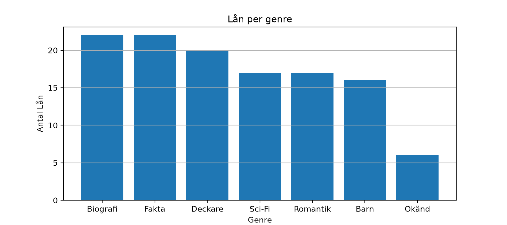
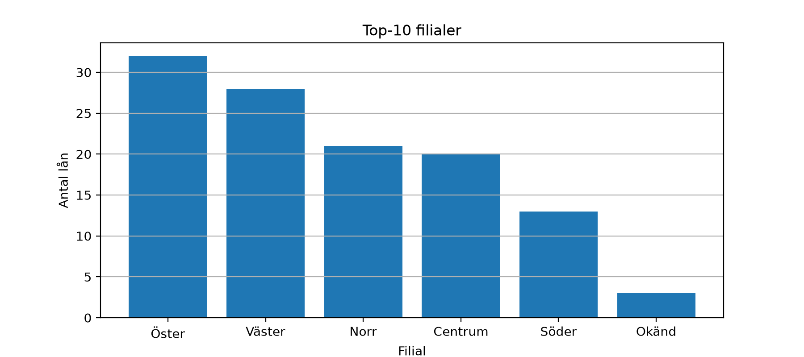
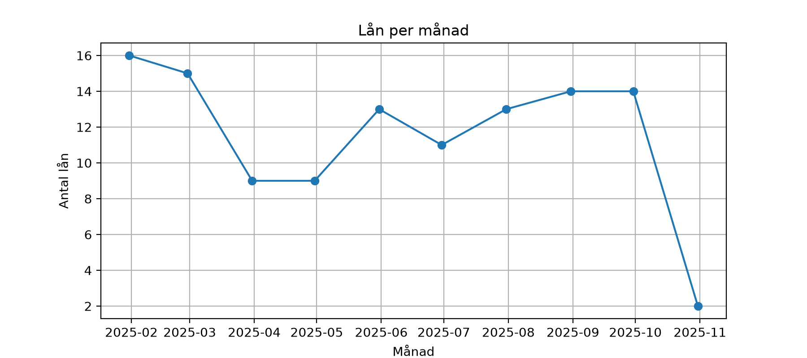
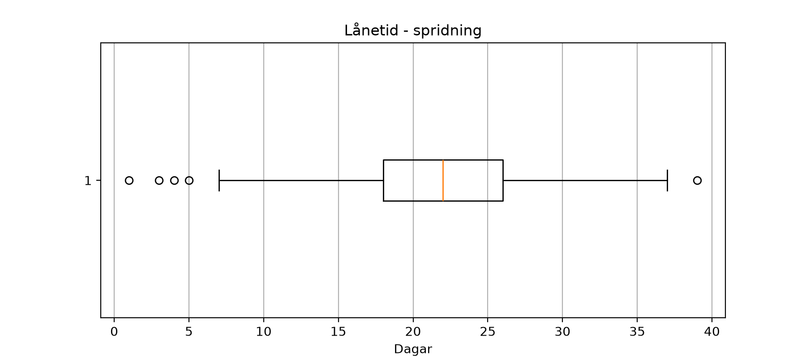

# EDA - Biblioteketsutlåning

## Rapport
### Nyckeltal (från notebooken, efter lätt städning)
- **Total antal lån:** 116
- **Genomsnittlig lånetid:** 21.3 dagar
- **Andel lån på övertid:** 47.6%

### Figurer





### Tabeller(expoterade)
- `data/pivot_branch_x_genre.csv`

### Slutsatser baserat på aktuell data
- **Topp-genre:** 1.Biografi (22), 2.Fakta(22), 3.Deckare(20).
- **Topp-filialer:** 1.Öster(32), 2.Väster(28), 3.Norr(21).
- **Säsongstopp:** 2025-02 med **16** unika lån/mån 
- **Policy-notering:** Övertidsandelen ligger på **47.6%** - följ upp med påminnelser


## MiljÖ
- **Python:** 3.14.7
- **Paket:** `Pandas`,`matplotlib`(se requirements.txt`)

## Kom igång

```bash
# Klona projektet
git clone https://github.com/roshima-fernando/EDA---Biblioteket.git 
cd library-eda

# Skapa och aktivera virtuella miljö
python m venv .venv
# Windows PowerShell
.venv\Scripts\Activate

# macOS/Linux
# source .venv/bin/activate

# instalera beroenden
python -m pip install -r requirements.txt
``` 


